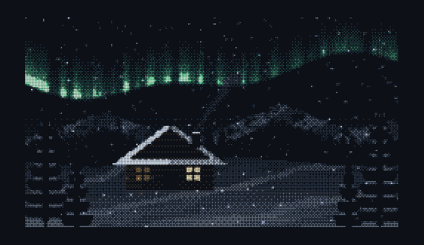
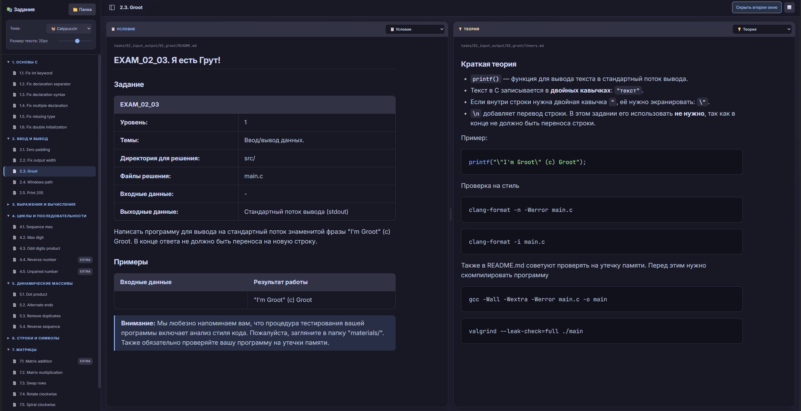
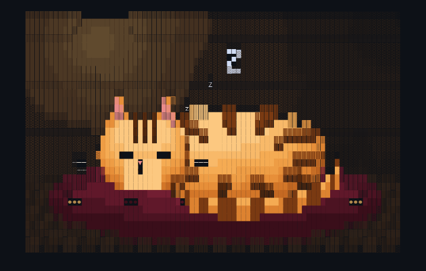

<div align="center">
  

# 🎯 Тренажёр по C

**Подготовка к экзамену в Школе 21**

Условия, теория, примеры решений и автотесты — в одном месте.
</div>

---

## 🚀 Быстрый старт

1. Скачай или склонируй репозиторий.
2. Открой `trainer.html` в браузере на базе Chromium: Chrome, Edge, Brave или Opera.
3. Нажми **«Выбрать папку проекта»** и укажи корень репозитория.
4. Разреши странице доступ к выбранной папке.
5. Выбери задание в дереве слева — его условие откроется справа.
6. Решай задачу в `main.c` в своём редакторе, затем запускай тесты.

Для быстрой проверки решений в заданиях есть автотесты.

<p align="center">
  
</p>

## 🛠 Инструменты

В корне проекта находятся две HTML-страницы.

| Файл | Назначение |
| --- | --- |
| `trainer.html` | Каталог заданий: условие, теория, тесты и решения. При открытии теории или решения экран делится на две части — удобно сравнивать материалы. |
| `theory_tests.html` | Отдельная страница с тестами по теории. |

### Почему HTML, а не отдельное приложение

Это осознанный выбор.

**Прозрачность.** HTML-файл можно открыть в обычном редакторе и посмотреть, что он делает. Не нужно запускать неизвестный исполняемый файл и доверять ему вслепую.

**Кроссплатформенность.** Один и тот же файл можно использовать в Windows, macOS и Linux. Не нужно собирать и поддерживать отдельные версии приложения для каждой системы.

### Почему нужен Chromium и выбор папки

Браузер не должен получать свободный доступ ко всем файлам компьютера. Поэтому тренажёр просит явно выбрать папку проекта.

Для этого используется **File System Access API**. Оно доступно в Chromium-браузерах, например Chrome, Edge, Brave и Opera, но не поддерживается Firefox и Safari в необходимом для тренажёра виде.

Папку выбираешь ты сам через системное окно. Это также позволяет не привязываться к конкретным путям Windows, macOS или Linux. Доступ выдаётся выбранной папке, а не всему диску.

---

## 🗂 Структура задания

В большинстве папок заданий находятся восемь файлов:

| Файл | Для чего нужен |
| --- | --- |
| `.clang-format` | Правила форматирования кода. |
| `main.c` | Файл, в котором нужно написать решение. В нём оставлена начальная структура программы. |
| `README.md` | Условие задания. |
| `run_test.sh` | Скрипт автоматической проверки: форматирование, компиляция, `cppcheck`, `valgrind` и тесты ввода/вывода. |
| `solution.c` | Один из вариантов решения. |
| `solution_commented.c` | То же решение с комментариями. |
| `tests.md` | Примеры ручной проверки и команды для работы с `cppcheck`, `valgrind` и компилятором. |
| `theory.md` | Объяснение подхода к решению. |

В таблице ниже перечислено **61 задание**. Автотесты помогают быстрее проверить работу: ручная проверка каждого задания даже по две минуты заняла бы около двух часов.

Если скрипт не запускается из-за отсутствия права на выполнение, перейди в папку задания и выполни:

```bash
chmod +x run_test.sh
./run_test.sh
```

Либо запусти скрипт через Bash:

```bash
bash run_test.sh
```

> **Обрати внимание:** в некоторых заданиях проверка ожидает `return 0` даже при некорректном вводе. Сверяйся с условием и тестами конкретного задания, а не переноси это правило на все программы.

---

## 📚 Разделы и задания

| Раздел | Темы | Заданий |
| --- | --- | ---: |
| [Основы C](tasks/01_basics/) | Типы данных, переменные, исправление ошибок | 6 |
| [Ввод и вывод](tasks/02_input_output/) | `scanf`, `printf`, форматирование и экранирование | 5 |
| [Выражения и вычисления](tasks/03_expressions/) | Формулы, округление, цифры и логика | 5 |
| [Циклы и последовательности](tasks/04_loops/) | Поиск максимума, обработка чисел, число без пары | 6 |
| [Динамические массивы](tasks/05_dynamic_arrays/) | Память, `realloc`, порядок элементов, удаление повторов | 5 |
| [Строки и символы](tasks/06_strings/) | Регистр, пробелы, слова, палиндромы, шифр Цезаря | 15 |
| [Матрицы](tasks/07_matrices/) | Сложение, умножение, перестановки, поворот и спирали | 6 |
| [Структуры](tasks/08_structures/) | `struct`, массивы структур, сортировка и фильтрация | 6 |
| [Текстовые файлы](tasks/09_text_files/) | `fopen`, `fgetc`, `fgets`, `fscanf`, справочник, калькулятор и шифр | 7 |
| **Итого** | | **61** |

<p align="center">
  
</p>

### Важно: это не официальный список экзаменационных заданий

Задания восстановлены по памяти и записям, поэтому не являются официальными. Формулировки, примеры и тесты могут отличаться от тех, что встречаются на настоящем экзамене.

Эталонные решения создавались с помощью ИИ и проверялись тестами этого репозитория, но не оригинальной системой проверки Школы 21. Если условие и тест расходятся, ориентируйся на условие и здравый смысл.

### Что означает суффикс `_extra`

Папки с суффиксом `_extra` содержат дополнительные тренировочные задания. Они помогают освоить тему с нуля, но **не подтверждены как экзаменационные**. Такие задачи могут не встретиться на экзамене или попасться в другом виде. Отсутствие суффикса тоже ничего не гарантирует.

---

## 📖 Полезные материалы

- [Памятка по C](docs/c_cheatsheet.md) — основные конструкции языка и частые ошибки.

<p align="center">
  
</p>
